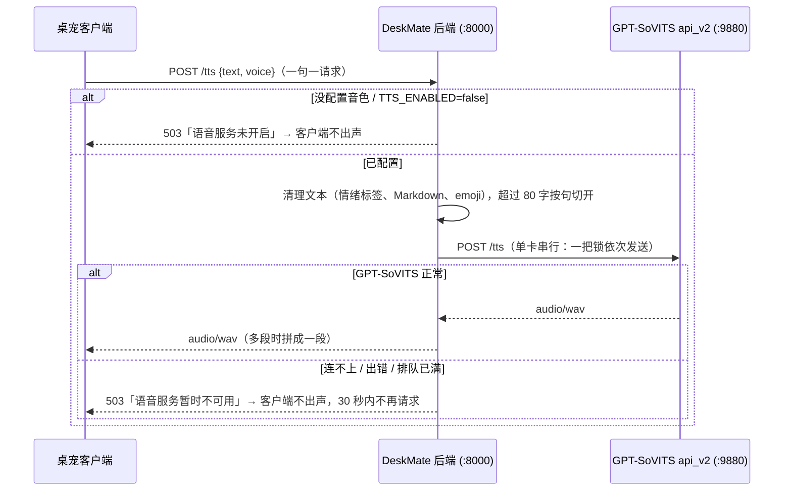

# GPT-SoVITS：桌宠唯一的声音

桌宠的朗读**只有 GPT-SoVITS 一种**：在主人电脑（需要 NVIDIA 显卡）上跑
[GPT-SoVITS](https://github.com/RVC-Boss/GPT-SoVITS)，小鲸就用你选的音色说话：离线、不花钱，音色由一段 3~10 秒的参考音频决定。
**没装、没配置或没启动 GPT-SoVITS 时，桌宠就不出声**（嘴巴照常动、聊天不受影响），没有任何备用语音
（以前的微软 Edge 语音和 Windows 系统语音都已移除）。「自己的 API Key」模式没有语音。

后端（`server/`）只是把要读的句子转发给本机的 GPT-SoVITS api_v2 服务，再把音频原样返回给客户端；
朋友的客户端不需要任何改动，**换音色只改服务器的配置**。

## 试听（语音效果示例）

示例为 AI 合成语音。

- [满穗-说话-定版示例.mp3](audio/满穗-说话-定版示例.mp3)
- [满穗-新版-new-1.mp3](audio/满穗-新版-new-1.mp3)

## 工作方式



- **没有备用**：GPT-SoVITS 不可用时 `/tts` 直接返回 503，客户端静音、嘴巴走正弦动画；连不上时后端 10 秒内不再去连，直接回 503。
- **串行**：一张显卡一次只合成一句，后端用一把锁排队；排队超过 `GSV_MAX_QUEUE`（默认 8 句）时多出来的句子不读，不会越积越多。
  用户按了停止、客户端已经断开的句子，轮到它时会被跳过。
- **长句**：单次最多 `GSV_MAX_CHARS`（默认 80）字，更长的按句号等切开、依次合成，wav 拼接成一段（句间留 0.12 秒停顿）。
  客户端本来就是一句一句发的，这只是兜底。
- **预热**：`GSV_WARMUP=true`（默认）时，后端启动后在后台等 GPT-SoVITS 就绪并先合成一句，免得第一句话等 10~30 秒。
- **音色**：客户端设置里的「音色」下拉框会从服务器的 `GET /tts/voices` 读取音色列表（旧版客户端发来的 Edge 音色名会映射成默认音色）。
- **健康检查**：`GET /health` 的 `gsv` 表示语音能不能用（没配置音色也是 `false`），`tts` 是默认音色名；
  设置里「测试连接」会显示「GPT-SoVITS 语音」或「语音服务未开启」，语音一栏也会提示「语音服务未开启」。

## 1. 安装 GPT-SoVITS

按官方仓库 [RVC-Boss/GPT-SoVITS](https://github.com/RVC-Boss/GPT-SoVITS) 的说明安装（Windows 有整合包，解压即用；
Linux / macOS 按 README 用 conda 或 pip 安装）。需要 NVIDIA 显卡，显存 4 GB 以上比较稳（8 GB 卡实测约占 2.7 GB）。

可以直接用官方底模，也可以用自己有权使用的声音微调一个模型（WebUI 里训练，得到 `GPT_weights_*/xxx.ckpt` 和 `SoVITS_weights_*/xxx.pth`）。

## 2. 启动 api_v2 服务

在 GPT-SoVITS 目录里：

```powershell
# Windows 整合包（runtime 里自带 Python）
runtime\python.exe api_v2.py -a 127.0.0.1 -p 9880 -c GPT_SoVITS/configs/tts_infer.yaml
```

```bash
# Linux / macOS
python api_v2.py -a 127.0.0.1 -p 9880 -c GPT_SoVITS/configs/tts_infer.yaml
```

- 用微调模型时，把 `tts_infer.yaml` 里 `custom` 段的 `t2s_weights_path` / `vits_weights_path` 改成你的模型，服务启动就会加载，不用每次请求传。
- **用 Docker 跑 DeskMate 后端、并且在 Linux 上**时，把 `-a 127.0.0.1` 改成 `-a 0.0.0.0`，容器才能经 `host.docker.internal` 连上
  （这时注意防火墙别把 9880 暴露到公网，它没有任何鉴权）。
- 起来以后检查一下：

```bash
curl -s -o /dev/null -w "%{http_code}\n" http://127.0.0.1:9880/control   # 返回 400 就是活着（它的设计如此），连不上才是没起
```

浏览器打开 `http://127.0.0.1:9880/docs` 能看到接口文档。

## 3. 准备参考音频

音色由参考音频决定（不是模型）：参考音频脏，输出就脏。

- 3~10 秒、单人、干净的人声 wav（没有背景音乐和混响），语气就是你想要的说话风格；
- 记下这段音频里说的**原话**（`prompt_text`）。**强烈建议填**：留空时服务要先对参考音频做一次识别，首次合成会慢很多；
- 路径是 **GPT-SoVITS 那台机器上**能读到的路径（DeskMate 后端只是原样转发，不读这个文件），建议写绝对路径。

## 4. 配置后端

最省事：运行一键部署脚本，在「配置 GPT-SoVITS 语音吗？」回答 y，按提示填地址、参考音频和原话
（也可以直接用参数：`-GsvRefAudio` / `--gsv-ref-audio` 等）：

```powershell
powershell -ExecutionPolicy Bypass -File scripts\deploy.ps1
```

```bash
bash scripts/deploy.sh
```

手动配置时改 `server/.env`（完整说明见 `server/.env.example`）。不需要选「提供方」——语音只有 GPT-SoVITS，配好音色就生效：

```ini
GSV_URL=http://127.0.0.1:9880
# 可选：整个服务器不朗读
# TTS_ENABLED=false
```

旧版的 `TTS_PROVIDER` / `TTS_FALLBACK` / `TTS_VOICE` 已废弃，留在 `.env` 里会被忽略（部署脚本会顺手删掉）。

然后二选一配置音色：

**A. 多个音色：写 `server/data/voices.json`**（已被 git 忽略；格式参考 `server/voices.example.json`）

```json
{
  "default": "小鲸",
  "voices": [
    {
      "name": "小鲸",
      "label": "小鲸 · 温柔",
      "ref_audio_path": "D:/GPT-SoVITS/refs/whale.wav",
      "prompt_text": "参考音频里说的那句话。",
      "prompt_lang": "zh",
      "text_lang": "zh",
      "speed": 1.0,
      "text_split_method": "cut0"
    }
  ]
}
```

| 字段 | 说明 |
| --- | --- |
| `name` | 音色 id（客户端设置里选的就是它），不超过 80 字 |
| `label` | 下拉框里显示的名字，省略时用 `name` |
| `ref_audio_path` | 参考音频路径（GPT-SoVITS 那台机器上） |
| `prompt_text` | 参考音频里的原话 |
| `prompt_lang` / `text_lang` | 参考音频 / 要合成的文字的语言：`zh` `en` `ja` `ko` `yue` `auto` |
| `speed` | 语速，0.9~2.0。**别低于 0.9**，它是时间拉伸，会出电音 |
| `text_split_method` | 默认 `cut0`（不切），切开再拼容易有爆音；长句由后端按句切 |

`default` 指定默认音色（旧客户端、没选过音色的朋友都用它），省略时用第一个。

**B. 只要一个音色：直接写在 `.env` 里**

```ini
GSV_VOICE_NAME=小鲸
GSV_REF_AUDIO=D:/GPT-SoVITS/refs/whale.wav
GSV_PROMPT_TEXT=参考音频里说的那句话。
GSV_PROMPT_LANG=zh
GSV_TEXT_LANG=zh
```

两种可以同时用：文件里没有同名音色时，`.env` 里的这个会追加进去。

两样都没有时不朗读（`/tts` 返回 503「语音服务未开启」）。

改完重启后端（`python app.py` 或 `docker compose up -d`），日志第一行会打印「语音合成：GPT-SoVITS @ …，音色：…」，
`http://127.0.0.1:8000/health` 里应看到 `"tts": "小鲸", "gsv": true`。

### 其他配置

| 变量 | 默认 | 说明 |
| --- | --- | --- |
| `GSV_MEDIA_TYPE` | `wav` | 返回格式 `wav` / `ogg`。见下 |
| `GSV_TIMEOUT` | `120` | 单次请求超时秒数（刚启动时第一句要 10~30 秒） |
| `GSV_MAX_CHARS` | `80` | 单次发给 GPT-SoVITS 的最多字数 |
| `GSV_MAX_QUEUE` | `8` | 最多排队几句，超出的句子不读 |
| `TTS_ENABLED` | `true` | 设成 `false` 整个服务器不朗读 |
| `GSV_WARMUP` | `true` | 启动后后台预热 |

**为什么默认 wav**：wav 是 GPT-SoVITS 的默认输出，无损、各种播放器都认，长句可以在后端无缝拼接；
一句话（约 3 秒、32 kHz 单声道）大概 150~200 KB，本机和局域网完全没压力。
朋友经内网穿透（花生壳 / cpolar 免费版带宽只有 1~4 Mbps）收听时会多等不到一秒，这时可以试试 `GSV_MEDIA_TYPE=ogg`：
体积约 1/10，客户端（Chromium 的 WebAudio）同样能直接播放；代价是 ogg 没法简单拼接，超过 80 字的句子改为交给 GPT-SoVITS 自己按标点切（`cut5`）。

### Docker

GPT-SoVITS 要用显卡，**放在宿主机上跑**，不放进容器（也没有官方镜像）。`compose.yaml` 已经把容器里的 `GSV_URL`
设成 `http://host.docker.internal:9880`（可用环境变量 `DESKMATE_GSV_URL` 覆盖）。音色二选一：

- `.env` 里的 `GSV_REF_AUDIO` 等单音色配置，直接生效；
- 多音色：取消 `compose.yaml` 里 `./server/data/voices.json` 那行挂载的注释，或者
  `docker compose cp server/data/voices.json server:/app/data/voices.json` 后 `docker compose restart server`。

`ref_audio_path` 写**宿主机**上的路径（由宿主机上的 GPT-SoVITS 读取）。

## 性能参考

| 项 | 值 |
| --- | --- |
| 首次请求（服务刚起） | 10~30 秒（所以有预热） |
| 之后每句（≤ 30 字） | 约 1.5~2.5 秒 |
| 显存 | 约 2.7 GB（RTX 4060 8 GB） |
| 并发 | 单卡串行，后端排队 |
| 输出 | 32 kHz wav（微调模型） |

客户端边输出边按句送去合成、按顺序播放，所以第一句读出来之前会有 1~3 秒延迟，之后基本连续。

## 常见问题

| 现象 | 原因 / 处理 |
| --- | --- |
| `/health` 里 `"gsv": false`，桌宠不出声 | `"tts": null` 是没配置音色（见第 4 步）；否则 GPT-SoVITS 没起或地址不对：检查 `GSV_URL`，`curl http://127.0.0.1:9880/control` 应返回 400 |
| 朋友的旧版客户端还是 Edge / 系统的声音 | 旧版客户端在 `/tts` 失败时会用自带的备用语音；GPT-SoVITS 正常时它们也用 GPT-SoVITS。更新到新版客户端后就只有 GPT-SoVITS |
| Docker 里 `gsv` 一直是 `false` | Linux 上 GPT-SoVITS 要用 `-a 0.0.0.0` 启动；确认 `DESKMATE_GSV_URL` 没设错 |
| 日志「GPT-SoVITS 返回 400: … prompt_text …」 | 必填字段缺了：检查音色的 `ref_audio_path`、`prompt_text` |
| 日志「GPT-SoVITS 返回 400: … media_type …」 | `GSV_MEDIA_TYPE` 只能是 `wav` / `ogg` |
| 日志「没有配置 GPT-SoVITS 音色」 | 没有 `server/data/voices.json`，`.env` 里也没填 `GSV_REF_AUDIO` |
| 日志「音色预设文件 … 读取失败」 | `voices.json` 格式错（JSON 里的反斜杠要写成 `\\` 或改用 `/`） |
| 返回音频很小 / 破音 | `speed` 低于 0.9 的时间拉伸伪影，调回 1.0 |
| 第一句要 20 秒以上 | 没填 `prompt_text`；或者关了 `GSV_WARMUP` |
| 明明起了却报找不到 `.ckpt` | GPT-SoVITS 的 `weight.json` / `tts_infer.yaml` 里缓存了旧模型路径，改成现存的模型 |
| 朗读断断续续、排队很久 | 句子太多、显卡太慢：日志里会有「排队已满」，多出来的句子不读；可以调大 `GSV_MAX_QUEUE` 或换更快的卡 |
| PowerShell 里用 curl 测试中文返回 422 | 控制台编码问题：把请求体存成 UTF-8 的 JSON 文件，用 `curl.exe --data-binary "@body.json"` |

## 合规

- **只对你有权使用的声音做合成**（自己的声音、获得授权的声音、明确允许二次创作的素材）。不要用来冒充真人。
- 对外分发合成的语音（包括让朋友通过你的服务器听到）时，建议标注为 AI 合成。
- 参考音频、微调模型、生成的音频都不要提交到仓库（`server/data/` 已被 git 忽略）。

## 以后可以做的

- 「自己的 API Key」模式目前没有语音；可以在设置里加一个「本机 GPT-SoVITS 地址」让客户端直连。
- 按音色切换 GPT / SoVITS 权重（`/set_gpt_weights`、`/set_sovits_weights`，需要在串行锁里切换并记住当前权重）。
- 流式合成（`streaming_mode`），进一步降低第一句的延迟。
