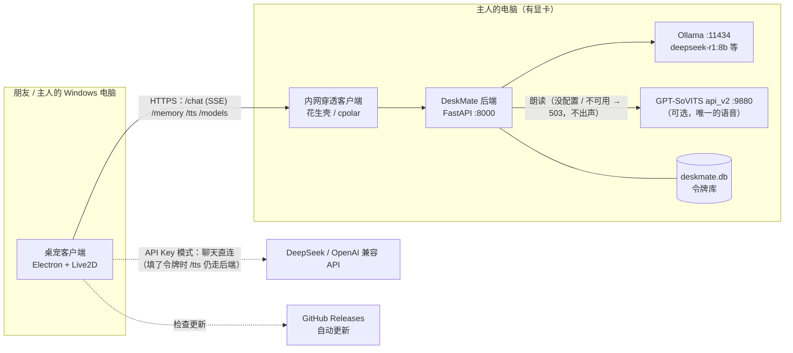
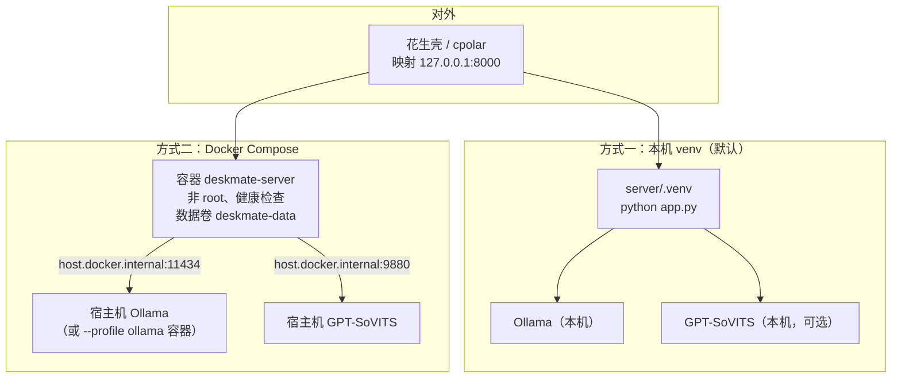
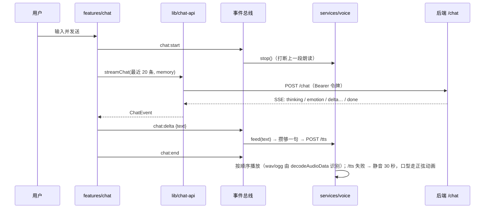
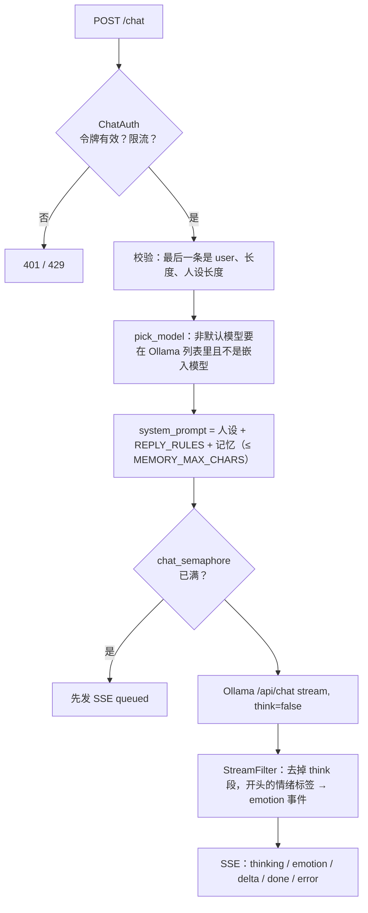
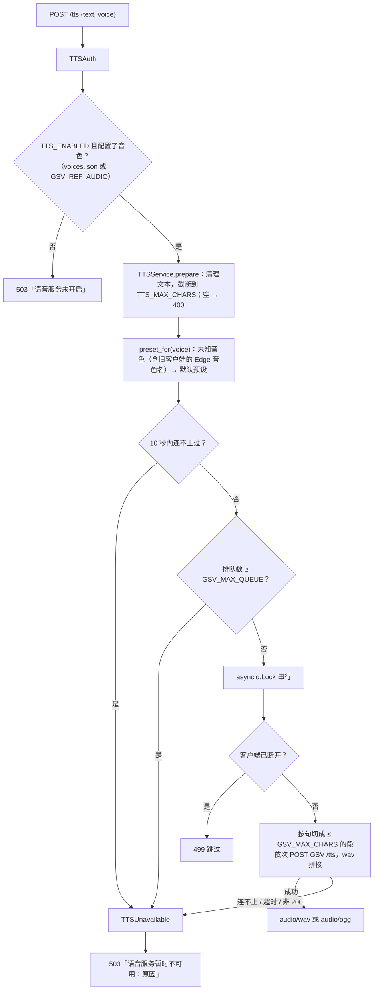
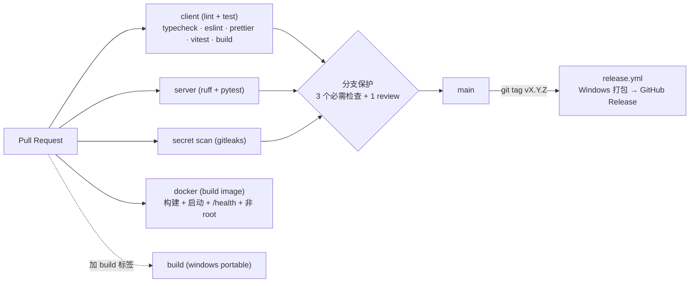

# DeepSeek DeskMate 架构文档

> 面向开发者和部署者。产品功能见 [产品设计文档](产品设计文档.md)，开发流程见 [CONTRIBUTING.md](../CONTRIBUTING.md)，
> GPT-SoVITS 配置见 [gpt-sovits.md](gpt-sovits.md)。

## 1. 系统上下文



- **官方模式**：客户端 → 内网穿透 → 后端 → Ollama。后端负责鉴权、限流、人设、过滤思考过程、解析情绪标签、朗读。
- **API Key 模式**：客户端直连 OpenAI 兼容接口，人设和流式过滤在客户端完成（与服务器同一套规则，测试保证一致）；没有语音。
- **语音只有 GPT-SoVITS**：要么是主人配置的音色，要么不出声，没有任何备用语音（Edge、系统语音都已移除）。
- 只有后端端口经内网穿透暴露；Ollama、GPT-SoVITS 都只听本机，不对外。

## 2. 部署视图



| 方式 | 命令 | 说明 |
| --- | --- | --- |
| 一键部署（Windows） | `powershell -ExecutionPolicy Bypass -File scripts\deploy.ps1` | 检查 Python/Node/Ollama → 拉模型 → venv → `.env` + 令牌 → 可选 GPT-SoVITS → 构建客户端 → 启动 |
| 一键部署（macOS/Linux） | `bash scripts/deploy.sh` | 同上，默认只部署后端（`--client` 构建客户端） |
| 一键部署 + Docker | `deploy.ps1 -Docker` / `deploy.sh --docker` | 后端用 compose 运行 |
| 手动 | 见 README「启动后端」 | |

两个脚本都支持非交互：`-Yes`/`--yes`、`-GsvRefAudio`、`-GsvUrl`、`-NoClient`、`-StartClient` 等，`-h` 查看。
GPT-SoVITS 那一步是可选的，跳过就不朗读。
这一步也可以选「下载作者共享的满穗音色」（`-FetchVoice` / `--fetch-voice`），调用 `scripts/fetch-voice.ps1`（`.sh`），见下面「音色资源分发」。
脚本可以重复运行：已有的 `.env` 会保留（废弃的 `TTS_PROVIDER` / `TTS_FALLBACK` / `TTS_VOICE` 会被删掉），只有第一次创建 `.env` 时才生成令牌。

## 3. 客户端架构

### 3.1 进程与模块

```mermaid
flowchart LR
    subgraph Main["主进程 src/main"]
        M1["index.ts 入口<br/>单实例"]
        M2["window.ts 透明置顶窗口<br/>drag.ts 拖动"]
        M3["settings.ts 设置 + DPAPI<br/>history.ts 记录/记忆"]
        M4["system.ts 剪贴板/通知"]
        M5["tray.ts autostart.ts<br/>updater.ts"]
        M6["ipc.ts 按契约实现处理函数"]
    end
    subgraph Pre["preload"]
        P1["createDeskApi()<br/>→ window.desk"]
    end
    subgraph R["渲染进程 src/renderer"]
        R0["main.ts 装配"]
        R1["core：bus / status / store / dom"]
        R2["services：bubble / voice / memory / menu"]
        R3["features：chat voice memory touch idle<br/>assistant greetings settings fortune outfit<br/>window-menu updater keyboard"]
        R4["pet：Live2D 加载与控制"]
        R5["lib：chat-api（两种连接 + SSE）<br/>stream-filter persona"]
    end
    SH["src/shared<br/>ipc.ts 契约 / types.ts / emotions.ts"]
    Main <-- "IPC（类型来自 shared/ipc.ts）" --> Pre --> R
    SH -.-> Main
    SH -.-> Pre
    SH -.-> R
```



- **类型化 IPC 契约**：`src/shared/ipc.ts` 定义 `InvokeContract` / `SendContract` / `EventContract` 和 `DESK_API`；
  preload 按 `DESK_API` 生成 `window.desk`，主进程用 `registerIpc` 注册——少实现一个通道会编译失败。
- **事件总线**：功能模块之间不互相 import，只通过 `core/bus.ts` 的 `AppEvents` 通信（如 `chat:start`、`chat:delta`、`pet:touched`），
  查询状态用 `status.get('replying')` 之类。装载顺序（`main.ts` 的 `FEATURES`）就是同一事件的处理顺序。
- **功能模块**：每个都是 `(ctx: AppContext) => void`，安装时订阅事件、注册右键菜单项（`MENU_ORDER` 决定位置）。
- **服务**：`voice`（句子切分 → 合成队列 → WebAudio 播放 + 口型分析器）、`bubble`（气泡）、`memory`（长期记忆整理）、`menu`。
- **角色配置**：`assets/live2d/<角色>/deskmate.json`（`configVersion, name, live2d{states, emotions, props, zones, notes, mouthParam…}, clickLines, touch, idle, outfit, fortune, greetings, reminders`），
  由 `character/config.ts` 校验（每个情绪标签必须有映射），`npm test` 会校验仓库里所有角色。

### 3.2 一次对话（官方模式）



- **语音只走服务器 GPT-SoVITS**：`services/voice.ts` 不再有任何备用（主进程 Edge 语音和 `speechSynthesis` 已删除，IPC 契约里也没有 `tts` 通道）。
  API Key 模式 `voiceSupported()` 为假，朗读开关灰掉；设置面板读 `/health` 的 `gsv`，为 `false` 时提示「语音服务未开启」。

### 3.3 构建、打包、发布

- **electron-vite** 分别构建 main / preload / renderer 到 `client/out/`；`vendor/`（Cubism Core）是渲染进程的 public 目录。
- 官方服务器默认地址在构建时注入（`build-env.ts` → `__DESKMATE_SERVER_URL__`，环境变量 `DESKMATE_SERVER_URL` 覆盖；一键部署脚本会设成本机后端）。
- **electron-builder** 打包 NSIS 安装版 + 便携版（`npm run dist`）。
- **发布**：推送 `v*` 标签 → `release.yml` 在 Windows 上检查标签 = `package.json` version → 下载 Cubism Core 和 Electron → 构建 →
  上传安装版、便携版、`latest.yml`、blockmap 到草稿 Release → 生成更新说明并发布。
- **自动更新**：安装版用 electron-updater（启动 15 秒后、每 6 小时），便携版只查 GitHub 最新版本并提示下载。

## 4. 服务器架构

### 4.1 包结构

```
server/
  app.py                     兼容入口 = python -m deskmate_server
  deskmate_server/
    main.py                  create_app(settings)：装配 state（auth、limiter、ollama、tts）、中间件、路由；lifespan 里启动 TTS 预热
    config.py                Settings（pydantic-settings）：环境变量 / server/.env，启动时校验类型和范围
    auth.py                  Bearer 鉴权（先令牌库后 ACCESS_TOKENS）+ 按令牌分桶限流（ChatAuth / TTSAuth）
    bodylimit.py             请求体上限 256 KB（Content-Length / chunked 都管），在解析和鉴权之前返回 413
    token_store.py tokens.py 令牌库（SQLite，只存 sha256）与命令行
    ratelimit.py             60 秒滑动窗口
    ollama.py                Ollama 客户端：探活、模型列表（排除嵌入模型，缓存 30 秒）、流式 / 非流式聊天
    persona.py               默认人设、REPLY_RULES（情绪标签来自 shared/emotion-tags.json）、记忆提示词
    stream_filter.py         流式过滤：去 <think>（跨 chunk）、解析开头的情绪标签
    tts/                     语音合成（只有 GPT-SoVITS）
      __init__.py            TTSService：清理文本；没配置 / TTS_ENABLED=false → 503「语音服务未开启」，GPT-SoVITS 失败 → 503，不退回任何别的语音
      base.py                Audio / VoiceInfo / TTSUnavailable
      gpt_sovits.py          GPTSoVITSProvider（httpx → api_v2；串行锁、排队上限、连不上后冷却 10 秒、长句切分 + wav 拼接、预热、/control 探活）
      voices.py              音色预设：GSV_VOICES_FILE（JSON）+ GSV_REF_AUDIO 等单音色环境变量
      text.py                朗读文本清理与按句切分（与客户端 cleanForSpeech 规则一致）
    logging_setup.py         访问日志中间件：request id、路径、状态、耗时、令牌标签
    schemas.py               请求体模型与长度上限
    routes/                  health  models  chat  memory  tts  admin
  tests/                     pytest + respx（模拟 Ollama / GPT-SoVITS），不读本机 .env
```

### 4.2 /chat 请求流程



- 只取最近 `MAX_HISTORY` 条历史；新版 Ollama 用 `think: false` 关闭思考，旧版靠 StreamFilter 兜底。
- 错误（Ollama 500、连不上）作为 SSE `error` 事件发给客户端，而不是断开连接。

### 4.3 鉴权与令牌

- `Authorization: Bearer <令牌>`；先查 SQLite 令牌库（sha256 比对，已撤销的拒绝），再查 `.env` 的 `ACCESS_TOKENS`（旧方式）。
  令牌库里撤销的令牌即使还写在 `ACCESS_TOKENS` 里也会被拒绝。
- 两者都为空时不鉴权（仅限本机调试，启动时告警）。
- 限流按令牌 id 分桶：`chat`（`/chat` `/memory` `/models` `/auth-check`，默认 20 次/分）和 `tts`（`/tts` `/tts/voices`，默认 90 次/分）互不占用。
- 日志只记令牌**标签**；管理接口 `/admin/*` 只有设置了 `ADMIN_TOKEN` 才存在（否则 404）。

### 4.4 语音合成（只有 GPT-SoVITS）

设计原则：**要么是 GPT-SoVITS 的声音，要么没声音**。服务器和客户端都没有备用语音（Edge、系统语音都已移除），
语音不可用时只是不出声，不影响聊天。



- 响应头 `Content-Type` 是 `audio/wav` 或 `audio/ogg`，另带 `X-TTS-Provider: gpt_sovits`；客户端按内容解码，不依赖格式。
- **向后兼容**：`POST /tts` 的请求体和「返回音频二进制」不变；旧客户端发来的 Edge 音色名映射成默认预设；
  `/health` 字段形状不变（`tts_provider` 固定为 `gpt_sovits`，旧客户端据此显示 GPT-SoVITS 状态）；
  `.env` 里残留的 `TTS_PROVIDER` / `TTS_FALLBACK` / `TTS_VOICE` 会被忽略，不会启动失败。
  旧客户端在 `/tts` 失败时仍会用它们自带的本机 Edge / 系统语音（那是旧客户端的逻辑，更新客户端后就没有了）。
- **扩展**：新增音色只改 `server/data/voices.json`；不要再加别的语音提供方或备用语音。
- **音色资源分发**：作者的满穗音色（GPT-SoVITS v2 权重 + 参考音频）不进本公开仓库，而是放在私有仓库
  `Mkerry12/DeepSeek-BoardMate-voice` 的 Release 附件里（带 `voice-manifest.json`：文件名、sha256、大小、预设参数），只对受邀协作者开放。
  `scripts/fetch-voice.ps1`（`.sh`）经 `gh release download` 下载、校验 sha256，把权重放进 GPT-SoVITS 的 `GPT_weights_v2` / `SoVITS_weights_v2`，
  参考音频放进 `server/data/voices/`，合并写入 `voices.json`，GPT-SoVITS 在线时用 `/set_gpt_weights`、`/set_sovits_weights` 切换权重。
  后端只在启动时读 `voices.json`，所以之后要重启后端。

### 4.5 长期记忆

`POST /memory`：把旧记忆（≤ `MEMORY_MAX_CHARS`）+ 最近对话（每条截 300 字、总长 ≤ 8000）交给模型按 `MEMORY_PROMPT` 整理，
非流式、去 `<think>`、在整行处截断；返回 `""` 表示没什么可记的。记忆**存在客户端**，服务器不保存。

### 4.6 配置

全部来自环境变量 / `server/.env`（`config.py` 的 `Settings`，启动时校验）。主要分组：

| 分组 | 变量 |
| --- | --- |
| 模型 | `OLLAMA_URL` `OLLAMA_MODEL` |
| 鉴权 | `ACCESS_TOKENS` `DB_PATH` `ADMIN_TOKEN` |
| 限额 | `RATE_LIMIT_PER_MIN` `MAX_CONCURRENCY` `MAX_HISTORY` `MAX_INPUT_CHARS` `MAX_PERSONA_CHARS` `MEMORY_MAX_CHARS` |
| 朗读 | `TTS_ENABLED` `TTS_MAX_CHARS` `TTS_RATE_PER_MIN`（旧的 `TTS_PROVIDER` `TTS_FALLBACK` `TTS_VOICE` 已废弃、会被忽略） |
| GPT-SoVITS | `GSV_URL` `GSV_VOICES_FILE` `GSV_VOICE_NAME` `GSV_REF_AUDIO` `GSV_PROMPT_TEXT` `GSV_PROMPT_LANG` `GSV_TEXT_LANG` `GSV_SPEED` `GSV_TEXT_SPLIT_METHOD` `GSV_MEDIA_TYPE` `GSV_TIMEOUT` `GSV_MAX_CHARS` `GSV_MAX_QUEUE` `GSV_WARMUP` |
| 运行 | `HOST` `PORT` `LOG_LEVEL` `LOG_FORMAT` |

## 5. 数据与存储

| 数据 | 位置 | 内容 | 备注 |
| --- | --- | --- | --- |
| `settings.json` | 客户端 `%APPDATA%\deepseek-deskmate\` | 连接方式、令牌、服务器地址、模型、人设、API 配置、提醒、换装、语音、问候记录、窗口位置、自动更新 | API Key 用 DPAPI 加密为 `keyEnc`；启动时补默认值、迁移旧字段 |
| `history.json` | 同上 | 聊天记录 | 最多 200 条 |
| `memory.json` | 同上 | 长期记忆笔记 + 计数 | 和聊天记录分开 |
| `logs/main.log` | 同上 | 主进程日志（更新等） | |
| `deskmate.db` | 服务器 `server/data/`（Docker：数据卷 `deskmate-data`） | 令牌：id、标签、sha256、创建 / 撤销 / 最后使用时间、每日请求数 | 不存明文令牌；git 忽略 |
| `voices.json` | 服务器 `server/data/` | GPT-SoVITS 音色预设 | git 忽略；示例 `server/voices.example.json` |
| `voices/*.wav` | 服务器 `server/data/voices/` | `fetch-voice` 下载的参考音频 | git 忽略 |
| `.env` | `server/.env` | 服务器配置与旧式令牌 | git 忽略，永远不提交 |
| `deskmate.json` | `client/assets/live2d/<角色>/` | 角色数据 | 随客户端打包 |
| `emotion-tags.json` | `shared/` | 情绪标签唯一来源 | 客户端构建时导入，服务器启动时读取（Docker 镜像里复制到 `/app/shared/`） |

## 6. API 参考

所有接口都在后端（默认 `http://127.0.0.1:8000`）。鉴权一列：「令牌」= `Authorization: Bearer <令牌>`（未配置任何令牌时不需要）。

| 方法 | 路径 | 鉴权 / 限流桶 | 请求 | 响应 |
| --- | --- | --- | --- | --- |
| GET | `/health` | 无 | — | `{ok, ollama, model, auth, tts, tts_provider, gsv}`；`tts` 是默认音色预设名（没配置时 `null`），`tts_provider` 固定 `gpt_sovits`，`gsv` 为 GPT-SoVITS 是否可用（没配置也是 `false`） |
| GET | `/auth-check` | 令牌 / chat | — | `{ok: true}`；401 令牌无效 |
| GET | `/models` | 令牌 / chat | — | `{models: [...], default}`（排除嵌入模型）；502 连不上 Ollama |
| POST | `/chat` | 令牌 / chat | `{messages: [{role: user\|assistant, content}], model?, persona?, memory?}` | `text/event-stream`：`{type: queued\|thinking\|emotion(value)\|delta(text)\|error(message)\|done}` |
| POST | `/memory` | 令牌 / chat | `{messages, memory?, model?}` | `{memory: "..."}` |
| POST | `/tts` | 令牌 / tts | `{text (1~4000), voice?}` | 音频二进制，`Content-Type: audio/wav\|audio/ogg`，`X-TTS-Provider: gpt_sovits`；400 无可读文字，503 语音服务未开启 / GPT-SoVITS 不可用 |
| GET | `/tts/voices` | 令牌 / tts | — | `{provider: gpt_sovits, default, voices: [{id, label}]}`（没配置时 `voices` 为空、`default` 为 `""`） |
| GET | `/admin/tokens` | `ADMIN_TOKEN` | — | `{tokens: [...]}`（未设置 `ADMIN_TOKEN` 时 404） |
| POST | `/admin/tokens` | `ADMIN_TOKEN` | `{label}` | `{id, label, token}`（令牌只返回这一次） |
| POST | `/admin/tokens/{标签或id}/revoke` | `ADMIN_TOKEN` | — | `{id, label, revoked: true}` |

所有响应带 `X-Request-ID`；错误体为 FastAPI 标准的 `{detail}`（中文）。

## 7. 安全模型

| 威胁 | 措施 |
| --- | --- |
| 陌生人蹭用服务器 | 令牌鉴权；令牌库只存 sha256；可随时撤销、立即生效 |
| 朋友刷爆显卡 | 按令牌限流（聊天 / 朗读分桶）；聊天并发上限 + 排队；GPT-SoVITS 串行 + 排队上限 |
| 内部服务暴露 | 只映射后端 8000；Ollama 和 GPT-SoVITS 无鉴权，**不要映射**；Docker 端口只绑定 127.0.0.1 |
| 令牌泄漏到日志 / 仓库 | 日志只记标签；`.env`、令牌库、`voices.json` 被 git 忽略；CI 和 pre-commit 跑 gitleaks |
| API Key 被读取 | DPAPI 加密落盘；API Key 模式直连接口，不经过任何服务器 |
| 管理接口被攻击 | 默认关闭（404）；开启时用常量时间比较 |
| 注入 / 超大请求 | Pydantic 限制所有字段长度；GPT-SoVITS 的参考音频路径只来自服务器配置，客户端只能选预设名 |
| 容器逃逸面 | 镜像非 root（1001）、白名单 `.dockerignore`、只含后端代码 |

## 8. CI/CD



- `ci.yml`：PR / main 推送触发；必需检查名称写在分支保护里，改 job 名要同步。
- `release.yml`：`v*` 标签触发，标签必须等于 `client/package.json` 的 version。
- Dependabot 管理依赖升级；Python 依赖用 uv 生成的锁定文件（`requirements*.txt`，Windows / Linux 通用）。
- **服务器改动不需要发版**：主人拉代码、`pip install -r requirements.txt`、重启后端即生效；客户端改动需要打标签发版，朋友的安装版会自动更新。

## 9. 测试策略

| 层 | 工具 | 覆盖 |
| --- | --- | --- |
| 客户端纯逻辑 | Vitest | 流式过滤、人设拼接（与服务器一致）、SSE 解析、两种连接、`/tts` 与 `/tts/voices`（失败不兜底、API Key 模式没令牌就无语音）、记忆、触摸、运势、问候时段、更新版本比较 |
| 客户端结构 | Vitest | 事件总线、设置迁移（含旧 Edge 音色名重置）、IPC 契约（通道齐全）、所有角色配置校验、情绪标签与服务器一致 |
| 服务器接口 | pytest + TestClient + respx | 鉴权、限流分桶、/health、/models 缓存与过滤、/chat SSE 过滤与历史截断、/memory |
| 服务器 TTS | pytest + respx | 没配置 / 关闭 → 503、连不上 / 出错 → 503 且不兜底（含冷却）、旧 env 变量被忽略、GPT-SoVITS 请求体映射、Edge 音色名映射默认预设、串行锁、排队上限、断开跳过、健康探测、音色列表、Content-Type 透传、长句切分与 wav 拼接、预热 |
| 令牌 | pytest | 令牌库增删改查、命令行、导入 `.env` |
| 镜像 | CI docker job | 构建、启动、健康检查、非 root |
| 部署脚本 | 本地 | PowerShell 语法解析、`bash -n` |

测试不依赖网络、显卡和本机 `.env`（`conftest.make_settings()` 显式给出全部配置）。

## 10. 扩展指南

- **新增情绪**：加到 `shared/emotion-tags.json` → 视需要在 `persona.py` 的 `REPLY_RULES` 补使用场景 → 每个角色的 `deskmate.json` 里 `live2d.emotions` 加映射（校验强制）。
- **新增功能模块**：`client/src/renderer/features/` 新建 `(ctx) => void`，加进 `main.ts` 的 `FEATURES`；菜单用 `ctx.menu.register(MENU_ORDER.xxx, …)`；
  跨模块通信先在 `AppEvents` 登记事件；可测逻辑导出纯函数写测试。
- **新增 IPC 通道**：只改 `src/shared/ipc.ts`，按编译错误补 `src/main/ipc.ts`。
- **新增角色**：`client/assets/live2d/<角色>/` 放模型 + `deskmate.json`，跑 `npm test` 校验。
- **语音**：刻意只有 GPT-SoVITS，不再新增提供方或备用语音（见 4.4）；加音色改 `server/data/voices.json`，改合成逻辑在 `tts/gpt_sovits.py`。
- **新增后端接口**：`routes/` 新建 `APIRouter` 加进 `ROUTERS`；参数里写 `_: ChatAuth` 获得鉴权和限流；请求体放 `schemas.py`；加测试。
- **新增配置项**：后端 `config.py` + `.env.example`（+ 需要时 `compose.yaml`）；客户端 `shared/types.ts`、`main/settings.ts`、设置面板。

## 11. 已知限制

- 客户端只正式支持 Windows（透明窗口、鼠标穿透、DPAPI、NSIS 都是 Windows 方案）。
- 官方模式依赖主人电脑在线和内网穿透；免费穿透带宽小，朗读音频（尤其 wav）会稍慢。
- GPT-SoVITS 单卡串行：多人同时朗读时排队，超出上限的句子不读；刚启动第一句慢（有预热）；和 Ollama 共用显卡时会互相拖慢。
- 语音完全依赖主人电脑上的 GPT-SoVITS：没开就不出声。API Key 模式要填访问令牌才有语音（占用主人电脑的 GPT-SoVITS）。
- 按音色切换 GPT-SoVITS 模型权重尚未支持，所有音色共用服务启动时加载的模型。
- 限流和排队状态在内存里，重启后端会清零；单进程部署，不支持多实例。
- 聊天记录只在本机，不跨设备同步。
